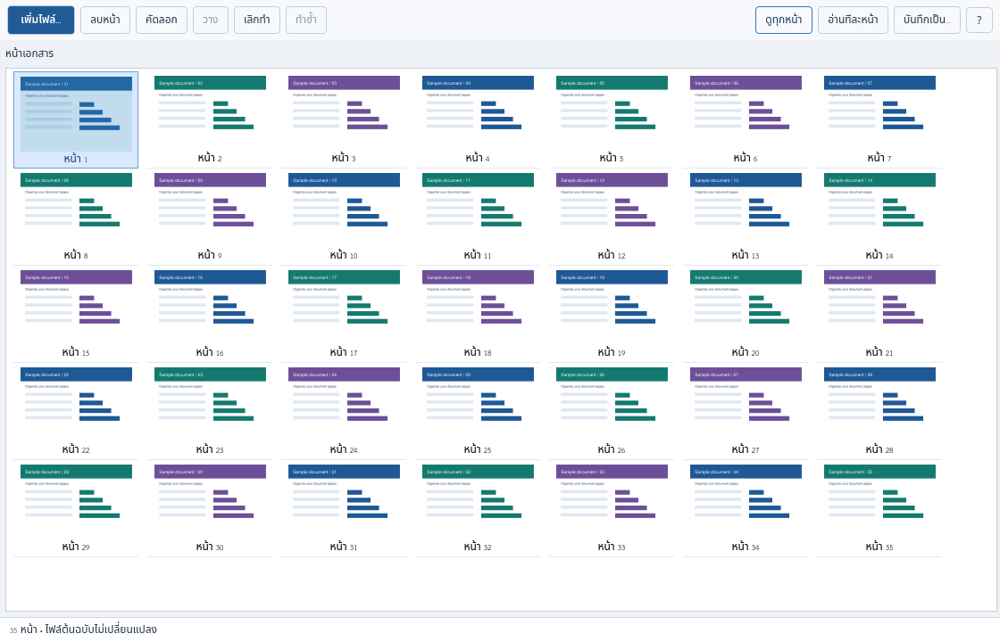

# GETEdit

<p align="center">
  <b>จัดหน้า PDF ง่าย ๆ — เพิ่ม ลบ ลากเรียง คัดลอก และวาง</b><br>
  <i>A free, open-source PDF page organizer for Linux and Windows.</i>
</p>

<p align="center">
  <a href="LICENSE"></a>
  
  
  <a href="https://github.com/n0ngXarm/GETEdit/actions/workflows/verify.yml"></a>
  <a href="https://ko-fi.com/n0ngXarm"></a>
  <a href="https://buymeacoffee.com/n0ngXarm"></a>
</p>

<p align="center">
  <a href="https://github.com/n0ngXarm/GETEdit/releases/download/v1.0.5/GETEdit-1.0.5-Linux-source.zip"></a>
  <a href="https://github.com/n0ngXarm/GETEdit/releases/download/v1.0.5/GETEdit-1.0.5-Windows-source.zip"></a>
</p>

<p align="center"><b>ใช้ฟรี ไม่ต้องสมัครสมาชิก</b> · แจกซอร์สพร้อมตัวเปิดโปรแกรม · ต้องมี Python ก่อนใช้งาน</p>

[ภาษาไทย](#ภาษาไทย) | [English](#english) | [รุ่นล่าสุด / Latest release](https://github.com/n0ngXarm/GETEdit/releases/latest)

---

## ภาษาไทย

**GETEdit** ช่วยรวมและจัดหน้าเอกสารผ่านตารางรูปย่อที่มองเห็นทุกหน้า เลือกไฟล์ ลากวางตามลำดับที่ต้องการ แล้วบันทึกเป็น PDF ใหม่ เอกสารต้นฉบับยังอยู่ครบ และประมวลผลในเครื่องโดยไม่อัปโหลดเอกสารขึ้นเซิร์ฟเวอร์

### ดาวน์โหลดฟรี

| ระบบ | รุ่น 1.0.5 | เปิดโปรแกรมหลังติดตั้ง dependencies |
| --- | --- | --- |
| Linux | [ดาวน์โหลด ZIP](https://github.com/n0ngXarm/GETEdit/releases/download/v1.0.5/GETEdit-1.0.5-Linux-source.zip) | `sh Start-Linux.sh` หรือเมนู Nautilus Scripts |
| Windows | [ดาวน์โหลด ZIP](https://github.com/n0ngXarm/GETEdit/releases/download/v1.0.5/GETEdit-1.0.5-Windows-source.zip) | ดับเบิลคลิก `Start-Windows.bat` |

**แตก ZIP ก่อนใช้งาน ชุดนี้ต้องมี Python 3.10+ แบบ 64-bit และติดตั้ง dependencies ตามวิธีด้านล่าง ยังไม่ใช่ EXE/AppImage ที่รวม runtime ในตัว**

[ดูทุกรุ่นและบันทึกการเปลี่ยนแปลง](https://github.com/n0ngXarm/GETEdit/releases) · [ค่า SHA-256 สำหรับตรวจสอบ ZIP](https://github.com/n0ngXarm/GETEdit/releases/download/v1.0.5/SHA256SUMS.txt)

### ภาพตัวอย่าง



*ภาพจากโปรแกรมจริงโดยใช้เอกสารจำลอง ไม่มีเอกสารส่วนตัวในชุดดาวน์โหลด*

### ทำอะไรได้บ้าง

- **เพิ่มและรวมไฟล์:** เลือกหลายไฟล์ได้ หน้าใหม่จะต่อท้าย
- **ลากจัดลำดับ:** เลือกหน้าเดียวหรือหลายหน้าแล้วลากข้ามแถวได้
- **ลบหน้าที่ไม่ต้องการ:** เลือกหน้าแล้วกดลบ โดยไม่เปลี่ยนไฟล์ต้นฉบับ
- **คัดลอกและวางหน้า:** วางสำเนาต่อจากหน้าที่เลือก หรือวางในเอกสารว่าง
- **เลิกทำ / ทำซ้ำ:** ย้อนขั้นตอนเมื่อจัดผิดได้
- **อ่านทีละหน้า:** ดับเบิลคลิกรูปย่อเพื่อดูภาพใหญ่และซูม
- **เมนูคลิกขวาบน Linux:** เลือกไฟล์ → Scripts → GETEdit
- **คีย์ลัดอยู่ในปุ่ม ?:** กด ? หรือ F1 เพื่อดูวิธีใช้งาน

### วิธีติดตั้ง

ติดตั้ง dependencies ครั้งแรกต้องใช้อินเทอร์เน็ต หากต้องการนำเข้า Word/Excel/PowerPoint ให้ติดตั้ง LibreOffice แยกต่างหาก

<details open>
<summary><b>Linux</b></summary>

แตก ZIP แล้วเปิด Terminal ในโฟลเดอร์โปรแกรม:

```sh
python3 -m venv .venv
.venv/bin/python -m pip install -r requirements.txt
sh Start-Linux.sh
```

เพิ่มเมนูคลิกขวาใน Files / Nautilus:

```sh
sh install-linux.sh
```

จากนั้นเลือกไฟล์ → คลิกขวา → **Scripts → GETEdit**

ตัวติดตั้งเมนูไม่ใช้ sudo และไม่ติดตั้งแพ็กเกจให้อัตโนมัติ เก็บโฟลเดอร์โปรแกรมไว้ที่เดิม หากย้ายโฟลเดอร์ หรืออัปเดตจาก 1.0.1 หรือต่ำกว่า ให้รัน `sh install-linux.sh` อีกครั้ง

เครื่อง Linux แบบ minimal อาจต้องติดตั้งแพ็กเกจ EGL ของ distribution เช่น `libegl1` ก่อนโหลด Qt

</details>

<details>
<summary><b>Windows</b></summary>

ติดตั้ง Python 3.10+ แบบ 64-bit พร้อม Python Launcher แล้วแตก ZIP และเปิด Terminal ในโฟลเดอร์โปรแกรม:

```bat
py -3 -m venv .venv
.venv\Scripts\python.exe -m pip install -r requirements.txt
Start-Windows.bat
```

ครั้งต่อไปดับเบิลคลิก **Start-Windows.bat** ได้เลย หากเกิดข้อผิดพลาด หน้าต่าง Terminal จะแสดงข้อความไว้ให้ตรวจสอบ

</details>

<details>
<summary><b>ติดตั้งจาก Git / Source</b></summary>

```sh
git clone https://github.com/n0ngXarm/GETEdit.git
cd GETEdit
```

จากนั้นทำตามวิธี Linux หรือ Windows ด้านบน

</details>

### เริ่มใช้งาน

1. กด **เพิ่มไฟล์…** แล้วเลือกเอกสารที่ต้องการ
2. กดค้างที่รูปย่อแล้วลากเรียงหน้า เส้นสีน้ำเงินบอกตำแหน่งที่จะวาง
3. เลือกหน้าเพื่อลบ คัดลอก หรือวางสำเนาได้ตามต้องการ
4. กด **บันทึกเป็น…** แล้วตั้งชื่อ PDF ใหม่

ปุ่ม **?** มุมขวาบนรวบรวมคีย์ลัดไว้ เช่น Ctrl+C / Ctrl+V, Ctrl+Z / Ctrl+Y และการเลือกหลายหน้า

### ไฟล์ที่รับเข้า

| ประเภท | ตัวอย่างและเงื่อนไข |
| --- | --- |
| PDF | ต้องปลดรหัสผ่านก่อน |
| รูปภาพ | PNG, JPEG, BMP, TIFF หลายหน้า, WebP, GIF, ICO ตามตัวอ่าน Qt; ภาพเคลื่อนไหวใช้เฟรมแรก |
| ข้อความ | TXT, CSV, TSV, JSON, XML, MD, LOG แบบ UTF-8/UTF-16 แสดงเป็นข้อความ |
| เอกสารอื่น | HTML, SVG, XPS, EPUB, MOBI, FB2, CBZ ตามตัวอ่าน MuPDF |
| Office | Word, Excel, PowerPoint และบาง template ต้องมี LibreOffice |

ตัวเลือกไฟล์ไม่จำกัดนามสกุล แต่การแปลงขึ้นกับตัวอ่านที่มีอยู่ **ไฟล์โปรแกรม เพลง วิดีโอ หรือข้อมูลที่แปลงเป็นหน้าไม่ได้จะมีข้อความแจ้ง** รูปแบบและฟอนต์อาจเปลี่ยนเมื่อแปลง Office จึงควรตรวจหน้าก่อนบันทึก

ขอบเขตคือจัดหน้าเอกสาร ไม่แก้ข้อความหรือรูปเดิมภายในหน้า ผลลัพธ์เป็น PDF และการจัดหน้าจะไม่รักษาลายเซ็นดิจิทัลเดิม

### แจ้งปัญหา / เสนอแนะ

เปิด [GitHub Issues](https://github.com/n0ngXarm/GETEdit/issues) พร้อมระบุระบบปฏิบัติการ รุ่นโปรแกรม ขั้นตอนที่พบปัญหา และข้อความผิดพลาดได้เลย กรุณาใช้ไฟล์ตัวอย่างที่ไม่มีข้อมูลส่วนตัว

<details>
<summary><b>ข้อมูลเพิ่มเติม: การบันทึก / ถอนเมนู / การทดสอบ</b></summary>

- เขียนไฟล์ชั่วคราวให้ครบก่อนเผยแพร่เป็นชื่อปลายทาง และไม่เขียนทับไฟล์เดิม
- ปลายทางต้องรองรับ hard link เช่น ext4, Btrfs หรือ NTFS; หากไม่รองรับให้บันทึกในเครื่องแล้วคัดลอกไปภายหลัง
- เก็บประวัติเลิกทำสูงสุด 10 ครั้ง และลดประวัติเมื่อรวมเกิน 128 MB โดยเก็บครั้งล่าสุดอย่างน้อยหนึ่งครั้ง
- ถอนเมนู Linux โดยลบเฉพาะ `GETEdit` ใน `~/.local/share/nautilus/scripts` หรือ `$XDG_DATA_HOME/nautilus/scripts`
- การแปลง Office จำกัด 90 วินาทีต่อไฟล์
- GitHub Actions ตรวจ regression และ stress บน Linux/Windows; Windows desktop ยังไม่มีการตรวจรับโดยคน

```sh
python -m unittest discover -s tests -v
python scripts/stress_check.py
```

ดู [ผล CI ของรุ่น 1.0.5](https://github.com/n0ngXarm/GETEdit/actions/runs/42173481471), [รายละเอียดการตรวจสอบ](VALIDATION.md) และ [บันทึกการเปลี่ยนแปลง](CHANGELOG.md)

</details>

---

## English

**GETEdit** is a free, open-source PDF page organizer with a Thai interface. Add files, drag thumbnails to reorder pages, delete unwanted pages, copy/paste pages, and undo/redo changes. Save to a new PDF while preserving the original files.

**[Download the latest release](https://github.com/n0ngXarm/GETEdit/releases/latest)** — choose the Linux or Windows source ZIP and extract it first. **Python 3.10+ (64-bit) is required. These are source packages, not standalone EXE/AppImage installers.**

Install the existing runtime dependencies once:

```sh
# Linux
python3 -m venv .venv
.venv/bin/python -m pip install -r requirements.txt
sh Start-Linux.sh
# Optional Nautilus right-click entry:
sh install-linux.sh
```

```bat
:: Windows
py -3 -m venv .venv
.venv\Scripts\python.exe -m pip install -r requirements.txt
Start-Windows.bat
```

PDFs, supported images, UTF-8/UTF-16 text and supported MuPDF documents can be imported. Office documents require LibreOffice. Not every file type/version can be converted; the app reports unsupported inputs. Processing happens locally. Press **? / F1** for shortcuts and mouse guidance.

Report reproducible problems in [Issues](https://github.com/n0ngXarm/GETEdit/issues), using sample files without private information.

---

## สนับสนุนผู้พัฒนา / Support & Donation

GETEdit เปิดให้ใช้งาน **ฟรีและเปิดซอร์ส** ภายใต้ AGPL-3.0-only การสนับสนุนเป็นทางเลือก และไม่มีผลต่อการใช้งานโปรแกรม

หากโปรแกรมช่วยให้จัดเอกสารได้สะดวกขึ้น สามารถสนับสนุนผู้พัฒนาได้ผ่านช่องทางเดียวกับโปรเจกต์อื่นของเรา:

<details>
<summary><b>PromptPay QR — คลิกเพื่อดู</b></summary>
<br>

</details>

<details>
<summary><b>Ko-fi / Buy Me a Coffee</b></summary>

- [Ko-fi — n0ngXarm](https://ko-fi.com/n0ngXarm)
- [Buy Me a Coffee — n0ngXarm](https://buymeacoffee.com/n0ngXarm)

</details>

## License

GETEdit is licensed under **[GNU AGPL-3.0-only](LICENSE)**. You may use and redistribute it under those terms. See [NOTICE](NOTICE) and [THIRD_PARTY.md](THIRD_PARTY.md) for dependency notices.
